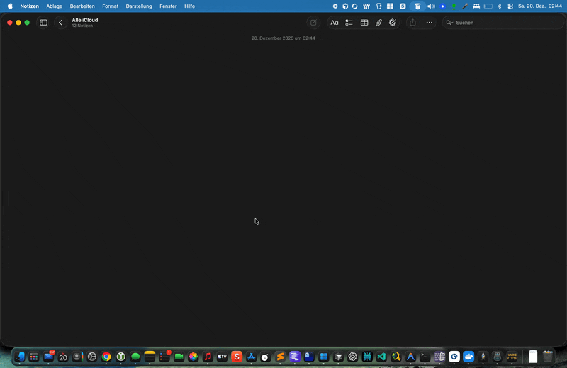

# PulseScribe

[](https://github.com/KLIEBHAN/pulsescribe/actions/workflows/rust.yml)

[🇺🇸 English Version](README.md)

**Spracheingabe für macOS und Windows** – inspiriert von [Wispr Flow](https://wisprflow.ai).

Hotkey drücken, sprechen, loslassen – Text erscheint. Das war's.

<p align="center">
  
</p>

## Features

- **Echtzeit-Streaming** – ~300ms Latenz mit Deepgram
- **Live-Text offline** – lokales Whisper mit dem MLX-Backend und dem Modell turbo (die Standards auf Apple Silicon) zeigt deine Worte im Overlay, während du sprichst; ein optionales Streaming-Modell zeigt sie Wort für Wort mit jedem lokalen Modell
- **Mehrere Provider** – Deepgram, OpenAI, Groq oder lokales Whisper
- **LLM-Nachbearbeitung** – Transkriptionen bereinigen mit GPT/Llama
- **Kontext-Awareness** – Passt Stil an aktive App an (E-Mail, Chat, Code)
- **Visuelles Feedback** – Animiertes Overlay zeigt den Aufnahmestatus und meldet Fehler beim Einfügen oder Kopieren
- **Letztes Diktat retten** – **Copy Last Transcript** im Menüleisten- oder Tray-Menü kopiert das letzte Diktat der laufenden Sitzung, auch wenn das automatische Einfügen scheitert. Frühere Sitzungen sind weiterhin unter Settings → History → Transcripts verfügbar.

## Inhaltsverzeichnis

- [Installation](#installation)
- [Schnellstart](#schnellstart)
- [Hotkey-Konfiguration](#hotkey-konfiguration)
- [Provider-Auswahl](#provider-auswahl)
- [LLM-Nachbearbeitung](#llm-nachbearbeitung)
- [Bekannte Einschränkungen](#bekannte-einschränkungen)
- [Troubleshooting](#troubleshooting)
- [Dokumentation](#dokumentation)

---

## Installation

### Fertige Installer (empfohlen)

Download von [Releases](https://github.com/KLIEBHAN/pulsescribe/releases):
- **macOS (Apple Silicon):** `PulseScribe-{version}-macOS-arm64-Full.dmg` (lokal + Cloud) oder `PulseScribe-{version}-macOS-arm64-Slim.dmg` (nur Cloud)
- **Windows (x64):** `PulseScribe-{version}-Windows-x64-Full-Setup.exe` (lokal + Cloud) oder `PulseScribe-{version}-Windows-x64-Slim-Setup.exe` (nur Cloud)

Über **Nach Updates suchen…** im Menüleisten-/Tray-Menü oder **Diagnose → Nach Updates suchen**
prüft PulseScribe auf neue GitHub-Releases und öffnet die verifizierte Download-Seite. Details: [Updates und Releases](docs/UPDATES.md).

**Benötigte Berechtigungen (macOS):**
- **Mikrofon** – Systemeinstellungen → Datenschutz & Sicherheit → Mikrofon
- **Bedienungshilfen** – Für Auto-Paste (Cmd+V Simulation)
- **Eingabemonitoring** – Für Hold-to-Record Hotkeys

### Aus dem Quellcode bauen (Rust)

Benötigt Rust ≥ 1.88 (`cmake` nur für `--features all-local`):

```bash
git clone https://github.com/KLIEBHAN/pulsescribe.git && cd pulsescribe

# Nur Cloud-Anbieter (Slim)
cargo run --release -p pulsescribe-desktop

# Vollversion mit lokaler Offline-ASR (whisper-rs + sherpa-onnx)
cargo run --release -p pulsescribe-desktop --features all-local
```

**Autostart:** Direkt unter **Einstellungen → Allgemein → Beim Anmelden starten** aktivieren. Siehe [macOS Build](docs/BUILDING_MACOS.md) und [Windows Build](docs/BUILDING_WINDOWS.md).

---

## Schnellstart

### 1. API-Key besorgen

| Provider | Gratis-Kontingent | Key holen |
|----------|-------------------|-----------|
| **Deepgram** (empfohlen) | 200$ Guthaben | [console.deepgram.com](https://console.deepgram.com) |
| **Groq** | Kostenlos | [console.groq.com](https://console.groq.com) |
| **OpenAI** | Pay-as-you-go | [platform.openai.com](https://platform.openai.com/api-keys) |

### 2. Konfigurieren

```bash
# Beispiel-Config kopieren
cp .env.example ~/.pulsescribe/.env

# Mit deinem API-Key bearbeiten
nano ~/.pulsescribe/.env
```

Minimale `~/.pulsescribe/.env`:

```bash
DEEPGRAM_API_KEY=dein_key_hier
PULSESCRIBE_MODE=deepgram
```

Das Mikrofon wählst du unter **Settings → Transcription → Microphone** und übernimmst
es mit **Save & Apply** ab der nächsten Aufnahme. **System default** folgt dem
Standardgerät des Betriebssystems. **Refresh** lädt die Geräteliste neu. Fehlt ein
gespeichertes Mikrofon, wird vorübergehend automatisch ein Eingabegerät gewählt.

### 3. Starten & Nutzen

**PulseScribe** über `/Applications` (macOS), das Startmenü (Windows) oder aus dem Quellcode per `cargo run --release -p pulsescribe-desktop` starten.

**Standard-Hotkeys:**
- **macOS:** `Fn` (Globe-Taste) halten → sprechen → loslassen
- **Windows:** `Ctrl+Win` halten → sprechen → loslassen

### Windows-Performance

Unter Windows nutzt PulseScribe standardmäßig das **`snappy`-Latenz-Preset**
(kurze Aufnahme-/Finalize-Puffer für schnelle Übergänge). Wortenden schützt
der **adaptive Stop-Nachlauf** automatisch: Wer den Hotkey mitten im Wort
loslässt, bekommt einen längeren konservativen Aufnahme-Nachlauf – nach einer
Sprechpause endet die Aufnahme dagegen fast sofort.

Falls auf deinem Mikrofon trotzdem letzte Wörter abgeschnitten werden,
wechsle in der `.env` auf konservative Puffer:

```bash
PULSESCRIBE_WINDOWS_LATENCY_PRESET=safe
```

Alle Tuning-Optionen sind in
[docs/KONFIGURATION.md](docs/KONFIGURATION.md) dokumentiert.

---

## Hotkey-Konfiguration

### Modi

| Modus | Verhalten | Geeignet für |
|-------|-----------|--------------|
| **Hold** (Standard) | Taste halten → sprechen → loslassen | Schnelle Diktate |
| **Toggle** | Drücken → sprechen → nochmal drücken | Längere Aufnahmen |

Beide Modi können gleichzeitig aktiv sein.

### Konfiguration

In `~/.pulsescribe/.env`:

```bash
# Hold-to-Record (Push-to-Talk)
PULSESCRIBE_HOLD_HOTKEY=fn          # macOS: Fn/Globe-Taste
PULSESCRIBE_HOLD_HOTKEY=ctrl+win    # Windows Standard

# Toggle (Drücken-Start, Drücken-Stop)
PULSESCRIBE_TOGGLE_HOTKEY=f19       # Empfohlen für macOS
PULSESCRIBE_TOGGLE_HOTKEY=ctrl+alt+r # Windows Standard
```

### Unterstützte Formate

| Format | Beispiele |
|--------|-----------|
| Funktionstasten | `f1`, `f12`, `f19` |
| Einzeltasten | `fn`, `capslock`, `space` |
| Kombinationen | `cmd+shift+r`, `ctrl+alt+space` |

### Visuelles Feedback

Das Overlay ist monochrom; Farbe markiert nur Ergebnisse.

| Status | Overlay | Bedeutung |
|--------|---------|-----------|
| Listening | Ruhende niedrige Balken, „Listening…“ | Hotkey gedrückt, wartet auf Sprache |
| Recording | Balken folgen der Stimme, Live-Text | Sprache erkannt, Aufnahme läuft |
| Preparing / Transcribing / Refining | Linie mit wanderndem Lichtschimmer, Statustext | Modell lädt, Text wird verarbeitet, LLM-Nachbearbeitung |
| Done | Grünes Badge „Pasted“ | Text eingefügt |
| No speech | Gelbes Badge „No speech“ | Nichts eingefügt |
| Paste/Copy fehlgeschlagen | Gelbes Badge „Not pasted“, × | Transkript kopiert bzw. über „Copy Last Transcript“ verfügbar |
| Error | Rotes Badge „Error“, × | Fehler aufgetreten |

Fehler und fehlgeschlagenes Einfügen/Kopieren bleiben sichtbar, bis du auf das Overlay klickst oder die nächste Aufnahme startest; sonst gehen Klicks durch das Overlay hindurch.

---

## Provider-Auswahl

| Provider | Latenz | Methode | Geeignet für |
|----------|--------|---------|--------------|
| **Deepgram** | ~300ms | WebSocket | Täglicher Gebrauch (empfohlen) |
| **Groq** | ~1s | REST | Gratis-Tier, schnell |
| **OpenAI** | ~2-3s | REST | Höchste Qualität |
| **Lokal** | variiert | Whisper | Offline, Datenschutz |

```bash
# In ~/.pulsescribe/.env
PULSESCRIBE_MODE=deepgram  # oder: openai, groq, local, openai_compatible (eigener Server, siehe docs/KONFIGURATION.md)
```

### Lokaler Modus (Offline)

Den **Full**-Installer installieren (enthält lokale `whisper-rs`-Metal/CPU- und `sherpa-onnx`-Backends) oder mit `--features all-local` bauen, dann unter **Einstellungen → Allgemein** den Anbieter **Lokal** wählen (oder Modelle unter **Einstellungen → Lokale Modelle** laden). Fehlende lokale Modelle werden beim ersten Einsatz auch automatisch heruntergeladen.

```bash
# In ~/.pulsescribe/.env
PULSESCRIBE_MODE=local
PULSESCRIBE_LOCAL_MODEL=turbo
```

Siehe [Lokale Backends](docs/LOKALE_BACKENDS.md) für alle Optionen.

---

## LLM-Nachbearbeitung

Aktiviere Refine um Transkriptionen zu bereinigen:

- Entfernt Füllwörter (ähm, also, quasi)
- Korrigiert Grammatik und Zeichensetzung
- Interpretiert Sprach-Commands ("neuer Absatz" → ¶)

```bash
# In ~/.pulsescribe/.env
PULSESCRIBE_REFINE=true
PULSESCRIBE_REFINE_PROVIDER=groq  # Gratis-Tier
```

### Kontext-Awareness

PulseScribe erkennt die aktive App und passt den Schreibstil an:

| Kontext | Apps | Stil |
|---------|------|------|
| `email` | Mail, Outlook | Formell, vollständige Sätze |
| `chat` | Slack, Discord | Locker, kurz |
| `code` | VS Code, Terminal | Technisch, Begriffe beibehalten |

### Sprach-Commands

Mit aktiviertem Refine funktionieren diese gesprochenen Befehle:

| Sprechen | Ergebnis |
|----------|----------|
| "neuer Absatz" | ¶ |
| "Komma" | `,` |
| "Fragezeichen" | `?` |

Siehe [Konfigurations-Referenz](docs/KONFIGURATION.md) für alle Refine-Optionen.

---

## Bekannte Einschränkungen

| Bereich | Einschränkung |
|---------|---------------|
| **Plattformen** | Linux noch nicht unterstützt |
| **LLM Refine** | Erfordert Netzwerk (kein lokales LLM) |
| **Custom Vocabulary** | Nicht von OpenAI API unterstützt |
| **Windows GPU** | Erfordert manuelle cuDNN-Installation |
| **Unsignierte Builds** | macOS: Bedienungshilfen nach jedem Rebuild neu autorisieren |

---

## Troubleshooting

| Problem | Lösung |
|---------|--------|
| API-Key fehlt | `DEEPGRAM_API_KEY` (oder Schlüssel des gewählten Anbieters) in Einstellungen → Allgemein oder `~/.pulsescribe/.env` setzen |
| Mikrofon geht nicht | OS-Mikrofonberechtigung und gewähltes Eingabegerät unter Einstellungen → Allgemein prüfen |
| Keine Berechtigung | Mikrofon + Bedienungshilfen + Eingabemonitoring in den Systemeinstellungen freigeben (macOS) |
| Auto-Paste funktioniert nicht | App in Bedienungshilfen neu hinzufügen (macOS) oder **Letztes Transkript kopieren** nutzen |

**Logs:** `~/.pulsescribe/logs/pulsescribe.log`

**Diagnose:** Einstellungen → Diagnose → Diagnose exportieren

Weitere Lösungen unter [Detailliertes Troubleshooting](#detailliertes-troubleshooting) unten.

---

## Dokumentation

| Dokument | Beschreibung |
|----------|--------------|
| [Konfigurations-Referenz](docs/KONFIGURATION.md) | Alle Einstellungen und Umgebungsvariablen |
| [CLI-Referenz](docs/CLI_REFERENCE.md) | Kommandozeilen-Optionen für `pulsescribe` (`pulsescribe-cli`) |
| [Lokale Backends](docs/LOKALE_BACKENDS.md) | Offline-Transkription einrichten |
| [Sicherheit & Datenschutz](docs/SICHERHEIT.md) | Datenverarbeitung und Berechtigungen |
| [Netzwerk-Anforderungen](docs/NETZWERK.md) | Endpunkte und Firewall-Regeln |
| [macOS Build](docs/BUILDING_MACOS.md) | App-Bundle und DMG-Erstellung |
| [Windows Build](docs/BUILDING_WINDOWS.md) | EXE und NSIS-Installer-Erstellung |
| [Updates & Releases](docs/UPDATES.md) | Release-Prozess und Update-Prüfung |
| [Beitragen](CONTRIBUTING.md) | Entwicklungs-Setup und Richtlinien |

---

## CLI-Nutzung

Für Skripte und Automatisierung die eigenständige `pulsescribe`-CLI (`crates/cli`) verwenden:

```bash
# Datei transkribieren
pulsescribe audio.mp3

# Vom Mikrofon aufnehmen
pulsescribe --record --copy

# Mit LLM-Nachbearbeitung
pulsescribe --record --refine --context email
```

Aus einem Quellcode-Checkout per `cargo run --release -p pulsescribe-cli -- <args>`. Siehe [CLI-Referenz](docs/CLI_REFERENCE.md) für alle Optionen.

---

## Detailliertes Troubleshooting

### Auto-Paste funktioniert nicht (macOS App Bundle)

**Symptom:** Bedienungshilfen werden als fehlend gemeldet, obwohl PulseScribe eingetragen ist.

**Ursache:** Lokal ad-hoc signierte Builds ändern ihren Signatur-Hash bei jedem Rebuild. Offizielle Releases nutzen ein festes Signaturzertifikat, sodass Berechtigungen bei Updates erhalten bleiben.

**Lösung:**
1. Systemeinstellungen → Datenschutz & Sicherheit → Bedienungshilfen
2. PulseScribe entfernen (Minus-Button)
3. PulseScribe neu hinzufügen (Plus-Button oder Drag & Drop)

### Zwischenablage-Verhalten

Standardmäßig bleibt der transkribierte Text in der Zwischenablage nach dem Paste. Um die vorherige Zwischenablage wiederherzustellen:

```bash
# In ~/.pulsescribe/.env
PULSESCRIBE_CLIPBOARD_RESTORE=true
```

### Log-Dateien

```bash
# Rotierendes Desktop-/Daemon-Log
~/.pulsescribe/logs/pulsescribe.log
```

### Häufige Probleme

| Problem | Lösung |
|---------|--------|
| Lokales Modell fehlt | Unter Einstellungen → Lokale Modelle herunterladen (oder beim ersten Diktat automatisch laden lassen) |
| Transkription langsam | `deepgram` oder `groq` Modus nutzen, oder kleineres lokales Modell |
| Deepgram schneidet letztes Wort ab | Auf neueste Version updaten; Streaming leert Audio-Queue korrekt |

---

## Lizenz

MIT License – siehe [LICENSE](LICENSE) für Details.
