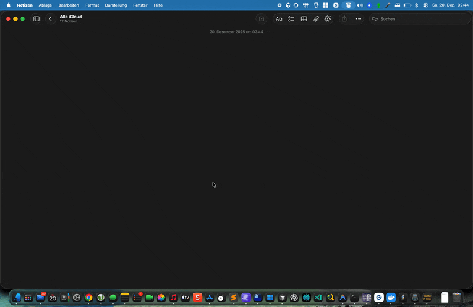

# PulseScribe

[](https://github.com/KLIEBHAN/pulsescribe/actions/workflows/rust.yml)

[🇩🇪 Deutsche Version](README.de.md)

**Voice input for macOS and Windows** – inspired by [Wispr Flow](https://wisprflow.ai).

Press a hotkey, speak, release – your text appears. That's it.

<p align="center">
  
</p>

## Features

- **Real-time Streaming** – ~300ms latency with Deepgram
- **Live Text Offline** – local Whisper with the MLX backend and the turbo model (the defaults on Apple Silicon) shows your words in the overlay while you speak; an optional streaming model shows them word by word with every local model
- **Multiple Providers** – Deepgram, OpenAI, Groq, or local Whisper
- **LLM Post-processing** – Clean up transcriptions with GPT/Llama
- **Context Awareness** – Adjusts style based on active app (email, chat, code)
- **Visual Feedback** – Animated overlay shows recording status and reports paste or clipboard failures
- **Recover Your Last Dictation** – Choose **Copy Last Transcript** in the menu bar or tray menu to copy the last dictation from this session, even if auto-paste failed. Earlier sessions remain available in Settings → History → Transcripts.

## Table of Contents

- [Installation](#installation)
- [Quick Start](#quick-start)
- [Hotkey Configuration](#hotkey-configuration)
- [Provider Selection](#provider-selection)
- [LLM Post-Processing](#llm-post-processing)
- [Known Limitations](#known-limitations)
- [Troubleshooting](#troubleshooting)
- [Documentation](#documentation)

---

## Installation

### Pre-built Installers (Recommended)

Download from [Releases](https://github.com/KLIEBHAN/pulsescribe/releases):
- **macOS (Apple Silicon):** `PulseScribe-{version}-macOS-arm64-Full.dmg` (local + cloud) or `PulseScribe-{version}-macOS-arm64-Slim.dmg` (cloud-only)
- **Windows (x64):** `PulseScribe-{version}-Windows-x64-Full-Setup.exe` (local + cloud) or `PulseScribe-{version}-Windows-x64-Slim-Setup.exe` (cloud-only)

Use **Check for Updates…** in the menu bar/tray or **Diagnostics → Check for Updates**
to check for new GitHub releases and open the verified download page. See [Updates and releases](docs/UPDATES.md).

**macOS permissions required:**
- **Microphone** – System Settings → Privacy & Security → Microphone
- **Accessibility** – For auto-paste (Cmd+V simulation)
- **Input Monitoring** – For hold-to-record hotkeys

### Build from Source (Rust)

Requires Rust ≥ 1.88 (and `cmake` only for `--features all-local`):

```bash
git clone https://github.com/KLIEBHAN/pulsescribe.git && cd pulsescribe

# Cloud-only desktop app (Slim)
cargo run --release -p pulsescribe-desktop

# Full desktop app with local offline ASR (whisper-rs + sherpa-onnx)
cargo run --release -p pulsescribe-desktop --features all-local
```

**Autostart:** Enable **Launch at login / Start with Windows** directly in **Settings → General**. See [Building macOS](docs/BUILDING_MACOS.md) and [Building Windows](docs/BUILDING_WINDOWS.md) for installer packaging.

---

## Quick Start

### 1. Get an API Key

| Provider | Free Tier | Get Key |
|----------|-----------|---------|
| **Deepgram** (recommended) | $200 credit | [console.deepgram.com](https://console.deepgram.com) |
| **Groq** | Free tier | [console.groq.com](https://console.groq.com) |
| **OpenAI** | Pay-as-you-go | [platform.openai.com](https://platform.openai.com/api-keys) |

### 2. Configure

```bash
# Copy example config
cp .env.example ~/.pulsescribe/.env

# Edit with your API key
nano ~/.pulsescribe/.env
```

Minimal `~/.pulsescribe/.env`:

```bash
DEEPGRAM_API_KEY=your_key_here
PULSESCRIBE_MODE=deepgram
```

Choose a microphone in **Settings → Transcription → Microphone**, then **Save & Apply**
to use it from the next recording. **System default** follows your OS input device.
**Refresh** reloads the device list. If a saved microphone is unavailable,
PulseScribe temporarily selects an input device automatically.

### 3. Start & Use

Launch **PulseScribe** from `/Applications` (macOS), the Start Menu (Windows), or from source via `cargo run --release -p pulsescribe-desktop`.

**Default hotkeys:**
- **macOS:** Hold `Fn` (Globe key) → speak → release
- **Windows:** Hold `Ctrl+Win` → speak → release

### Windows Performance

On Windows, PulseScribe uses the **`snappy` latency preset by default**
(short capture/finalize buffers for fast transitions). Final words are
protected automatically by the **adaptive stop tail**: releasing the hotkey
mid-word keeps a longer conservative recording tail, while releasing after a
silent pause finishes almost immediately.

If final words still get clipped on your microphone, switch to conservative
buffers in your `.env`:

```bash
PULSESCRIBE_WINDOWS_LATENCY_PRESET=safe
```

All tuning knobs are documented in
[docs/CONFIGURATION.md](docs/CONFIGURATION.md).

---

## Hotkey Configuration

### Modes

| Mode | Behavior | Best For |
|------|----------|----------|
| **Hold** (default) | Hold key → speak → release | Quick dictation |
| **Toggle** | Press → speak → press again | Longer recordings |

Both modes can be active simultaneously.

### Configuration

In `~/.pulsescribe/.env`:

```bash
# Hold-to-record (push-to-talk)
PULSESCRIBE_HOLD_HOTKEY=fn          # macOS: Fn/Globe key
PULSESCRIBE_HOLD_HOTKEY=ctrl+win    # Windows default

# Toggle (press-start, press-stop)
PULSESCRIBE_TOGGLE_HOTKEY=f19       # Recommended for macOS
PULSESCRIBE_TOGGLE_HOTKEY=ctrl+alt+r # Windows default
```

### Supported Formats

| Format | Examples |
|--------|----------|
| Function keys | `f1`, `f12`, `f19` |
| Single keys | `fn`, `capslock`, `space` |
| Combinations | `cmd+shift+r`, `ctrl+alt+space` |

### Visual Feedback

The overlay is monochrome; color only marks outcomes.

| Status | Overlay | Meaning |
|--------|---------|---------|
| Listening | Static low bars, "Listening…" | Hotkey pressed, waiting for speech |
| Recording | Bars follow your voice, live text | Speech detected, recording |
| Preparing / Transcribing / Refining | Line with a soft light sweeping across, status text | Model loading, processing, LLM post-processing |
| Done | Green "Pasted" badge | Text pasted |
| No speech | Amber "No speech" badge | Nothing was pasted |
| Paste/copy failed | Amber "Not pasted" badge, × | Transcript copied or available via Copy Last Transcript |
| Error | Red "Error" badge, × | Error occurred |

Errors and paste/copy failures stay visible until you click the overlay or start the next recording; otherwise clicks pass through the overlay.

---

## Provider Selection

| Provider | Latency | Method | Best For |
|----------|---------|--------|----------|
| **Deepgram** | ~300ms | WebSocket | Daily use (recommended) |
| **Groq** | ~1s | REST | Free tier, fast |
| **OpenAI** | ~2-3s | REST | Highest quality |
| **Local** | varies | Whisper | Offline, privacy |

```bash
# In ~/.pulsescribe/.env
PULSESCRIBE_MODE=deepgram  # or: openai, groq, local, openai_compatible (own server, see docs/CONFIGURATION.md)
```

### Local Mode (Offline)

Install the **Full** installer (includes local `whisper-rs` Metal/CPU and `sherpa-onnx` backends) or build with `--features all-local`, then select **Local** in **Settings → General** (or download models under **Settings → Local Models**). Missing local models are also downloaded automatically on first use.

```bash
# In ~/.pulsescribe/.env
PULSESCRIBE_MODE=local
PULSESCRIBE_LOCAL_MODEL=turbo
```

See [Local Backends](docs/LOCAL_BACKENDS.md) for all options.

---

## LLM Post-Processing

Enable refine to clean up transcriptions:

- Removes filler words (um, uh, like)
- Corrects grammar and punctuation
- Interprets voice commands ("new paragraph" → ¶)

```bash
# In ~/.pulsescribe/.env
PULSESCRIBE_REFINE=true
PULSESCRIBE_REFINE_PROVIDER=groq  # Free tier
```

### Context Awareness

PulseScribe detects the active app and adjusts writing style:

| Context | Apps | Style |
|---------|------|-------|
| `email` | Mail, Outlook | Formal, complete sentences |
| `chat` | Slack, Discord | Casual, concise |
| `code` | VS Code, Terminal | Technical, preserve terms |

### Voice Commands

With refine enabled, these spoken commands work:

| Speak | Result |
|-------|--------|
| "new paragraph" | ¶ |
| "comma" | `,` |
| "question mark" | `?` |

See [Configuration Reference](docs/CONFIGURATION.md) for all refine options.

---

## Known Limitations

| Area | Limitation |
|------|------------|
| **Platforms** | Linux not yet supported |
| **LLM Refine** | Requires network (no local LLM) |
| **Custom Vocabulary** | Not supported by OpenAI API |
| **Windows GPU** | Requires manual cuDNN installation |
| **Unsigned Builds** | macOS: Re-authorize Accessibility after each rebuild |

---

## Troubleshooting

| Problem | Solution |
|---------|----------|
| API key missing | Set `DEEPGRAM_API_KEY` (or your chosen provider key) in Settings → General or `~/.pulsescribe/.env` |
| Microphone not working | Check OS microphone permissions and selected input device in Settings → General |
| No permission | Grant Microphone + Accessibility + Input Monitoring in System Settings (macOS) |
| Auto-paste fails | Re-add PulseScribe in Accessibility settings (macOS) or use **Copy Last Transcript** |

**Logs:** `~/.pulsescribe/logs/pulsescribe.log`

**Diagnostics:** Settings → Diagnostics → Export Diagnostics

For more solutions, see the [full troubleshooting section](#detailed-troubleshooting) below.

---

## Documentation

| Document | Description |
|----------|-------------|
| [Configuration Reference](docs/CONFIGURATION.md) | All settings and environment variables |
| [CLI Reference](docs/CLI_REFERENCE.md) | Command-line options for `pulsescribe` (`pulsescribe-cli`) |
| [Local Backends](docs/LOCAL_BACKENDS.md) | Offline transcription setup |
| [Security & Privacy](docs/SECURITY.md) | Data handling and permissions |
| [Network Requirements](docs/NETWORK.md) | Endpoints and firewall rules |
| [Building macOS](docs/BUILDING_MACOS.md) | App bundle and DMG creation |
| [Building Windows](docs/BUILDING_WINDOWS.md) | EXE and NSIS installer creation |
| [Updates & Releases](docs/UPDATES.md) | Release process and update checks |
| [Contributing](CONTRIBUTING.md) | Development setup and guidelines |

---

## CLI Usage

For scripting and automation, use the standalone `pulsescribe` CLI (`crates/cli`):

```bash
# Transcribe file
pulsescribe audio.mp3

# Record from microphone
pulsescribe --record --copy

# With LLM post-processing
pulsescribe --record --refine --context email
```

From a source checkout, run `cargo run --release -p pulsescribe-cli -- <args>`. See [CLI Reference](docs/CLI_REFERENCE.md) for all options.

---

## Detailed Troubleshooting

### Auto-Paste Not Working (macOS App Bundle)

**Symptom:** Accessibility shows as missing even though PulseScribe is listed.

**Cause:** Locally built ad-hoc signed bundles change code signature hash on rebuild. Official releases use a pinned signing certificate so permissions persist across updates.

**Solution:**
1. System Settings → Privacy & Security → Accessibility
2. Remove PulseScribe (minus button)
3. Re-add PulseScribe (plus button or drag & drop)

### Clipboard Behavior

By default, transcribed text stays in clipboard after paste. To restore previous clipboard:

```bash
# In ~/.pulsescribe/.env
PULSESCRIBE_CLIPBOARD_RESTORE=true
```

### Log Files

```bash
# Rotating desktop/daemon log
~/.pulsescribe/logs/pulsescribe.log
```

### Common Issues

| Problem | Solution |
|---------|----------|
| Local model missing | Download it in Settings → Local Models (or trigger one dictation for auto-download) |
| Transcription slow | Use `deepgram` or `groq` mode, or a smaller local model |
| Deepgram cuts last word | Update to latest version; streaming drains audio properly |

---

## License

MIT License – see [LICENSE](LICENSE) for details.
